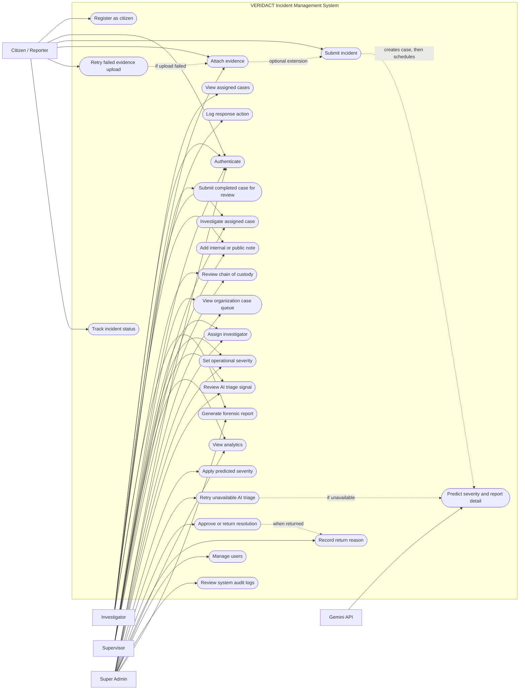
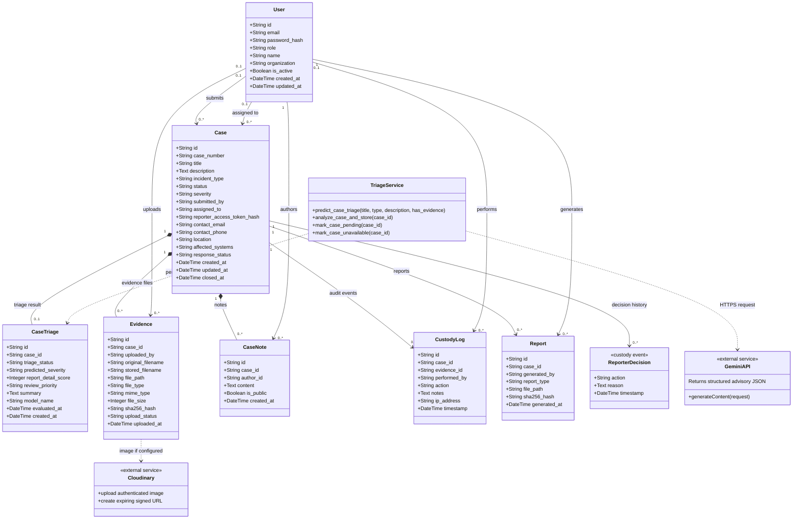
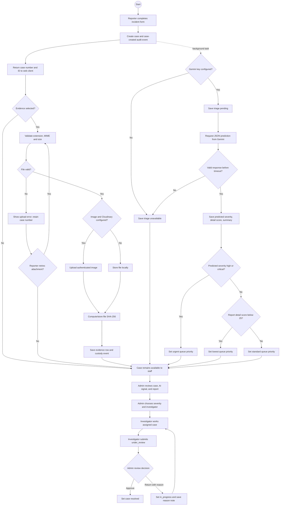
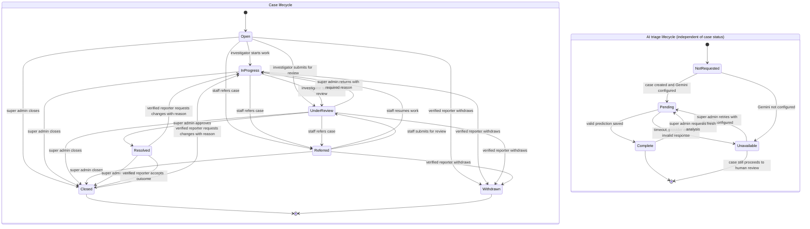

# VERIDACT Software Modelling

> Implementation-aligned UML views of public incident intake, evidence storage, Gemini-assisted triage, investigator work, and super-admin review.

## Scope and Modelling Notes

The active roles are citizen/reporter, investigator, supervisor, and super admin. Public incident intake can be anonymous. Investigators can read and update only cases assigned to them; supervisors and super admins can access the organization-wide queue. Only super admins can retry AI triage or make the final resolution decision.

Gemini returns an advisory severity prediction, a report-detail/verifiability score from 0 to 100, and a neutral summary. The score is not a probability that a complaint is truthful. Predicted high or critical severity always receives urgent queue priority; otherwise a report-detail score below 25 is low priority. Admins retain control of the case's operational severity and assignment.

Evidence upload is a second request after case creation. A failed attachment must not erase the created case: the frontend retains the case number and retries only the file. Images use authenticated Cloudinary storage when configured; other evidence uses local storage. Private image previews use short-lived signed URLs or the authenticated local-file endpoint.

## Use-Case Diagram



## Class Diagram



`Case.severity` is the operational severity set by staff; `CaseTriage.predicted_severity` is a separate AI suggestion. `report_detail_score` is not a truthfulness score. `review_priority` is derived: `urgent` for high/critical predicted severity, `low` for other predictions with a report-detail score below 25, and `standard` otherwise. Existing databases migrate the legacy `authenticity_score` value into `report_detail_score` without dropping data.

## Sequence Diagram: Submission, Triage, Evidence, and Staff Workflow

```mermaid
sequenceDiagram
    actor Reporter
    actor Investigator
    actor Admin as Super Admin
    participant Web as React Web Client
    participant API as FastAPI API
    participant CaseSvc as Case Service
    participant TriageSvc as Triage Service
    participant Gemini as Gemini API
    participant EvidenceSvc as Evidence Service
    participant Cloud as Cloudinary
    participant PDF as ReportLab PDF Generator
    participant DB as SQLite Database

    Reporter->>Web: Submit incident form
    Web->>API: POST /api/cases/anonymous
    API->>CaseSvc: create_case(payload)
    CaseSvc->>DB: Insert case and case-created custody log
    CaseSvc-->>API: Case ID and case number
    API->>TriageSvc: Schedule background triage when key configured
    API-->>Web: 201 case created with case number

    opt Gemini API key configured
        TriageSvc->>DB: Create/update triage row as pending
        TriageSvc->>Gemini: generateContent(incident text, evidence presence)
        alt Valid structured response
            Gemini-->>TriageSvc: predicted severity, report detail score, summary
            TriageSvc->>TriageSvc: Derive urgent, standard, or low priority
            TriageSvc->>DB: Persist completed triage result
        else Timeout, provider error, or invalid response
            TriageSvc->>DB: Persist unavailable status and manual-review message
        end
    else Gemini not configured
        TriageSvc->>DB: Persist unavailable status
    end

    opt Reporter attached evidence
        Web->>API: POST /api/cases/{id}/evidence (multipart file)
        API->>EvidenceSvc: Validate size/type and compute SHA-256
        alt Image and Cloudinary configured
            EvidenceSvc->>Cloud: Upload authenticated asset
            Cloud-->>EvidenceSvc: Cloudinary public ID
        else Non-image or Cloudinary not configured
            EvidenceSvc->>EvidenceSvc: Store file locally
        end
        EvidenceSvc->>DB: Insert evidence metadata and hash
        EvidenceSvc->>DB: Append evidence-uploaded custody log
        API-->>Web: 201 evidence metadata and hash
    end

    alt Evidence request fails after case creation
        API-->>Web: Upload error
        Web->>Web: Keep case number and case ID
        Reporter->>Web: Retry file upload
        Web->>API: POST /api/cases/{same id}/evidence
    end

    Admin->>Web: Review queue ordered by AI priority
    Web->>API: GET /api/cases
    API->>DB: Read cases and triage rows
    API-->>Web: Case list with score, prediction, priority
    Admin->>Web: Assign case and optionally apply predicted severity
    Web->>API: PATCH /api/cases/{id} (assigned_to and/or severity)
    API->>CaseSvc: update_case(...)
    CaseSvc->>DB: Persist assignment/severity and audit event

    Investigator->>Web: Work assigned case, add notes/actions
    Web->>API: PATCH /api/cases/{id} (note/status)
    API->>CaseSvc: update_case(...)
    CaseSvc->>DB: Persist work and audit event
    Investigator->>Web: Submit completed case for review
    Web->>API: PATCH /api/cases/{id} status=under_review
    API->>CaseSvc: update_case(...)
    CaseSvc->>DB: Persist under_review status

    alt Admin approves
        Admin->>Web: Approve resolution
        Web->>API: POST /api/cases/{id}/review decision=approve
        API->>CaseSvc: review_case(...)
        CaseSvc->>DB: Set resolved and append audit event
    else Admin returns with required reason
        Admin->>Web: Return for further work with reason
        Web->>API: POST /api/cases/{id}/review decision=return, reason
        API->>CaseSvc: review_case(...)
        CaseSvc->>DB: Set in_progress, save internal note and audit event
        Investigator->>Web: Complete requested follow-up and resubmit
    end

    opt Admin approves resolution
        CaseSvc->>PDF: Build internal report from all staff notes and custody details
        PDF-->>CaseSvc: Internal PDF and SHA-256
        CaseSvc->>PDF: Build reporter copy from public notes and sanitized milestones
        PDF-->>CaseSvc: Reporter-safe PDF and SHA-256
        CaseSvc->>DB: Save both report records and report-generated custody events
    end

    Reporter->>Web: Track case and verify ownership
    Web->>API: GET public case using case number
    opt Reporter supplies ownership credential
        Web->>API: Send JWT or X-Case-Access-Token header
        API->>DB: Verify citizen ownership or anonymous token hash
        API-->>Web: Reporter actions and report availability
    end
    opt Resolution report available
        Web->>API: GET /api/public/cases/{number}/investigation-report with ownership credential
        API-->>Web: Reporter-safe PDF download
    end
    alt Reporter accepts result
        Reporter->>Web: Accept and close case
        Web->>API: POST decision action=accept
        API->>DB: Set closed and append reporter decision event
    else Reporter requests more justification
        Reporter->>Web: Submit explanation/transparency reason
        Web->>API: POST decision action=request_changes, reason
        API->>DB: Set in_progress and append request/reason event
    else Reporter withdraws active complaint
        Reporter->>Web: Withdraw complaint
        Web->>API: POST decision action=withdraw
        API->>DB: Set withdrawn and append withdrawal event
    end
```

## Activity Diagram: Case Intake and AI-Assisted Triage



## State Diagram: Case and AI Triage Lifecycles



Case and triage states are independent: a case can be open or assigned while triage is pending or unavailable. An unavailable prediction never blocks the case workflow. Triage retry is super-admin-only. The ordinary admin queue ordering is urgent first, then standard, then low, with newest cases first inside each priority group; investigators see their assigned cases newest first.

## Implementation References

- Core case and triage models: [case.py](../backend/app/models/case.py), [case_triage.py](../backend/app/models/case_triage.py), [user.py](../backend/app/models/user.py)
- Evidence, notes, reports, and custody: [evidence.py](../backend/app/models/evidence.py), [case_note.py](../backend/app/models/case_note.py), [report.py](../backend/app/models/report.py), [custody_log.py](../backend/app/models/custody_log.py)
- AI scoring and priority derivation: [triage_service.py](../backend/app/services/triage_service.py)
- Case lifecycle, role filtering, and queue order: [case_service.py](../backend/app/services/case_service.py)
- Investigation PDF generation and SHA-256: [report_service.py](../backend/app/services/report_service.py)
- API endpoints: [cases.py](../backend/app/routes/cases.py), [evidence.py](../backend/app/routes/evidence.py), [auth.py](../backend/app/routes/auth.py)
- Public reporter tracking and decisions: [public.py](../backend/app/routes/public.py)
- Existing-database migration for the renamed score column: [database.py](../backend/app/database.py), [main.py](../backend/app/main.py)
